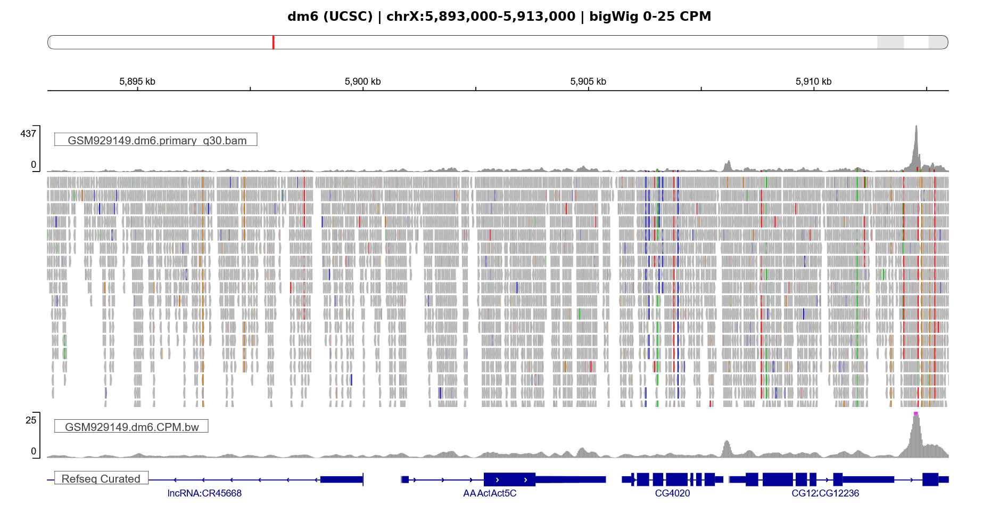

# Task 01 Report: MSL2 ChIP-seq Signal Processing & IGV Inspection (`GSM929149`)

## 1. Biological Context & Experimental Design
In *Drosophila melanogaster*, sex-chromosome dosage compensation equalizes X-linked gene expression between XY males and XX females by hypertranscribing the single male X chromosome approximately twofold. This transcriptional upregulation is mediated by the Male-Specific Lethal (MSL) ribonucleoprotein complex, in which **MSL2** serves as the essential male-specific DNA-binding core subunit that nucleates complex assembly at high-affinity **Chromatin Entry Sites (CES)** (such as the X-linked non-coding RNA locus *roX1*) and spreads *in cis* across active X-chromosomal genes (such as *Act5C*), while sparing autosomes (such as *RpL32*).

Dataset **`GSE37864` / `GSM929149`** (Straub *et al.*, 2013, *Genome Research* 23:473–485) profiles endogenous MSL2 occupancy via ChIP-seq in male-derived *Drosophila* **S2** cells using a polyclonal anti-MSL2 antibody. Examining a single biological replicate (`msl2_2`, run `SRR495368`) on the UCSC `dm6` assembly establishes baseline signal-to-noise behavior, alignment specificity, and expected X-versus-autosome enrichment patterns before multi-replicate peak calling and input normalization.

## 2. Dataset & Reference Provenance
- **Study / Sample:** GEO `GSE37864` / `GSM929149` (SRA `SRX146994` / `SRR495368`, biological replicate `msl2_2`), MSL2 ChIP-seq in *Drosophila melanogaster* male S2 cells (rabbit polyclonal anti-MSL2 serum; Illumina Genome Analyzer II, single-end 36 bp, 59,200,042 spots).
- **Primary Reference:** Straub T, Zabel A, Gilfillan GD, Feller C, Becker PB (2013), *Genome Research* 23:473–485 (`GSE37864`, doi:10.1101/gr.146407.112).
- **SRA Archive & FASTQ Verification:** Local SRA archive `data/raw/SRR495368/SRR495368.sra` verified consistent via `vdb-validate` (`logs/task_01/vdb_validate.SRR495368.log`). Deterministic reconversion via `fasterq-dump` (`logs/task_01/fasterq_dump.SRR495368.log`) matched the uncompressed MD5 of `data/raw/SRR495368.fastq.gz` (`ca17f2bdfb248389cf0aaf9bb455550d`, `logs/task_01/fastq_reconversion_check.txt`); compressed archive MD5 `c5ed574ae121cd8620d078ca5cc0f6bc` (`logs/task_01/SRR495368.fastq.md5`), 59,200,042 reads, uniform 36 bp read length (`logs/task_01/fastq_check.SRR495368.tsv`).
- **Reference Genome (`dm6`):** UCSC `dm6.fa.gz`, archive MD5 `4a6777324403eff92c3650c30af30120` verified against UCSC `md5sum.txt` (`dm6.fa.gz: OK` in `logs/task_01/dm6.fa.gz.md5check.txt`); uncompressed `dm6.fa` MD5 `5aadf7ccab5a6b674e76516bf75eaa89` (`logs/task_01/dm6.fa.md5`).

## 3. Software & Reproducibility
Orchestrated dynamically from `metadata/samples.tsv` via `scripts/run_all.sh` (`01_download.sh`–`04_coverage.sh`) in Conda environment `msl2-chipseq` (`environment.yml`, pinned `environment.lock.txt`). Versions recorded in `logs/task_01/software_versions.txt`:
- `prefetch`: `3.4.1` | `fasterq-dump`: `3.4.1` | `fastqc`: `v0.13.0` | `multiqc`: `1.35` | `bowtie2`: `2.5.5` | `samtools`: `1.24` | `bamCoverage` (deepTools): `4.0.0`

## 4. Alignment, Filtering & Duplicate Retention Rationale
Single-end 36 bp reads were aligned to `dm6` with `bowtie2 -p 4` (`logs/task_01/bowtie2.GSM929149.log`). Default end-to-end (`--sensitive`) alignment was chosen rather than local soft-clipping because Illumina GAII 36 bp ChIP-seq reads lack adapters at 3' ends and short 36-mers benefit from full-length seed-and-extend scoring to minimize spurious partial hits:
- **Total input reads:** 59,200,042 (100.00%)
- **Aligned 0 times (unaligned):** 16,909,465 (28.56%)
- **Aligned exactly 1 time:** 32,585,348 (55.04%)
- **Aligned >1 times:** 9,705,229 (16.39%)
- **Overall alignment rate:** **71.44%** (42,290,577 aligned reads)

Alignments were coordinate-sorted (`GSM929149.dm6.sorted.bam`) and filtered with `samtools view -F 0x904 -q 30` (`GSM929149.dm6.primary_q30.bam`), retaining **32,530,464** primary high-confidence reads (54.95% of total input reads; verified via `samtools quickcheck` in `logs/task_01/bam_integrity.txt`). Applying `MAPQ >= 30` removes the 16.39% multi-mapping fraction arising from repetitive elements and paralogous gene families on 36 bp reads so pileups reflect uniquely mappable chromatin loci.

**Duplication Summary:** Duplicate reads were quantified on a temporary copy of the filtered BAM using `samtools markdup -s` (`results/task_01/qc/GSM929149.dm6.primary_q30.markdup_stats.txt`), identifying **8,281,791** duplicate single-end reads (**25.46%** of the 32,530,464 filtered reads). Per standard ChIP-seq practice for single-end 36 bp libraries—where authentic focal binding at high-affinity sites like *roX1* produces identical 5' read starts—duplicates were **retained** (`GSM929149.dm6.primary_q30.bam` has no duplicate flags set) so narrow CES summits are not artificially truncated.

## 5. FastQC, MultiQC & Unmapped Read Investigation (`28.56%`)
FastQC inspection of raw reads (`results/task_01/qc/SRR495368_fastqc.html`), unmapped reads (`results/task_01/qc/SRR495368.unmapped_fastqc.html`), and the aggregated MultiQC report (`results/task_01/qc/multiqc_report.html`) summarizes library quality:

| QC Metric | Value | MultiQC Module | Interpretation |
| :--- | :--- | :--- | :--- |
| Total Raw Sequences (`SRR495368`) | 59,200,042 (36 bp) | FastQC | Matches SRA metadata (`n_spots = 59,200,042`) exactly |
| Raw GC Content / Adapter Content | 43% GC / <0.03% adapter | FastQC | Normal *Drosophila* genomic GC; negligible adapter carryover |
| Low-Quality Cycle-1 Reads (`Q = 2`) | ~30% of raw reads | FastQC | Illumina GAII chastity-failed reads (`#` quality across all 36 bp) |
| Unmapped Reads (`16,909,465`, 28.56%) | Median `Q = 2` + 100,423 all-`N` | Bowtie2 / FastQC | Low-confidence base calls across full read; trimming cannot rescue |
| Filtered Primary Reads (`MAPQ >= 30`) | 32,530,464 (54.95%) | SAMtools | Clean uniquely mapped fraction retained for coverage tracks |
| Optical/PCR Duplicate Rate | 25.46% (8,281,791 reads) | SAMtools `markdup` | Expected for 36 bp single-end ChIP-seq; retained to preserve CES peaks |

Because the 28.56% unaligned fraction consists overwhelmingly of reads assigned Phred quality 2 across all 36 cycles (plus 100,423 all-`N` reads) rather than 3' adapter contamination, quality trimming would discard those reads rather than recover additional alignments.

## 6. Chromosome-Level Alignment Breakdown (`MAPQ >= 30`)
From `results/task_01/qc/GSM929149.primary_q30.idxstats.txt` (total filtered primary reads = **32,530,464**):

| Chromosome | Length (bp) | Filtered Reads (`MAPQ >= 30`) | Density (reads/Mb) | Density / Major Autosomes |
| :--- | ---: | ---: | ---: | ---: |
| `chr2L` | 23,513,712 | 6,618,264 | 281,464 | 1.11 |
| `chr2R` | 25,286,936 | 6,164,115 | 243,767 | 0.96 |
| `chr3L` | 28,110,227 | 6,571,323 | 233,770 | 0.92 |
| `chr3R` | 32,079,331 | 8,340,542 | 259,997 | 1.02 |
| `chrX` | 23,542,271 | 4,494,154 | 190,897 | 0.75 |
| `chr4` | 1,348,131 | 222,131 | 164,770 | 0.65 |
| `chrY` | 3,667,352 | 6,891 | 1,879 | 0.01 |
| `chrM` | 19,524 | 18,404 | 942,635 | 3.71 |

In male S2 cells (`~2X;4A` aneuploid karyotype), roughly half the autosomal read density (`~0.50`) would be expected on `chrX` in the absence of specific binding; the observed `chrX` / major-autosome density ratio is **0.75** (`190,897` vs. `254,098` reads/Mb). This elevation is compatible with relative X enrichment driven by focal MSL2 binding, though copy-number variation, mappability, and background cannot be separated without an input control.

## 7. Normalized Coverage Track & Quantitative `pyBigWig` Verification
A 10 bp binned, 150 bp read-extended, CPM-normalized bigWig track (`results/task_01/tracks/GSM929149.dm6.CPM.bw`) was generated with `bamCoverage` (`logs/task_01/bamCoverage.GSM929149.log`; 1 CPM = 32.53 extended fragments). Window maxima and means were extracted programmatically with `pyBigWig` (`logs/task_01/GSM929149.bigwig_maxima.tsv`):

| Locus | Genomic Coordinates (`dm6`) | Peak Summit (`max_CPM`) | Window Mean (`mean_CPM`) | Selection Rationale |
| :--- | :--- | ---: | ---: | :--- |
| `roX1` | `chrX:3,850,000-3,870,000` | **228.22** | 4.220 | Known high-affinity X-linked Chromatin Entry Site (CES) |
| `Act5C` | `chrX:5,893,000-5,913,000` | **30.37** | 2.011 | Highly expressed X-linked housekeeping gene |
| `RpL32` | `chr3R:30,035,000-30,055,000` | **4.73** | 2.274 | Highly expressed autosomal comparison gene |

## 8. IGV Visual Inspection (Fixed Scale `[0 - 25]` CPM)
All three loci were inspected in IGV on `dm6` with assembly/coordinate banners, track labels visible, a fixed y-axis scale of `[0 - 25]` CPM on `GSM929149.dm6.CPM.bw`, and the `Refseq Curated` gene track displayed below:

1. **X-Linked High-Affinity Entry Site — `roX1` (`chrX:3,850,000-3,870,000`):** 
   *Figure 1. IGV-Web, `dm6`, `chrX:3,850,000-3,870,000`; tracks: `GSM929149.dm6.primary_q30.bam`, `GSM929149.dm6.CPM.bw` (`[0 - 25]` CPM), `Refseq Curated`.*
   A sharp local maximum (`228.22` CPM, clipping above the `[0 - 25]` display range) lies within `roX1`, consistent with strong MSL2 recruitment to the `roX1` Chromatin Entry Site.
2. **X-Linked Active Gene — `Act5C` (`chrX:5,893,000-5,913,000`):** 
   *Figure 2. IGV-Web, `dm6`, `chrX:5,893,000-5,913,000`; tracks: `GSM929149.dm6.primary_q30.bam`, `GSM929149.dm6.CPM.bw` (`[0 - 25]` CPM), `Refseq Curated`.*
   A focal maximum (`30.37` CPM) appears in the 3' region of `CG12236`, about 0.8 kb from `Shmt` (which starts 67 bp beyond the right edge of the window) and adjacent to `Act5C`, consistent with the reported association of the MSL complex with active X-linked genes; this single ChIP track alone cannot establish enrichment without an input control.
3. **Autosomal Comparison Region — `RpL32` (`chr3R:30,035,000-30,055,000`):** 
   *Figure 3. IGV-Web, `dm6`, `chr3R:30,035,000-30,055,000`; tracks: `GSM929149.dm6.primary_q30.bam`, `GSM929149.dm6.CPM.bw` (`[0 - 25]` CPM), `Refseq Curated`.*
   Signal stays well below the `[0 - 25]` CPM display ceiling (`max = 4.73` CPM) with no focal peak. The window mean (`2.27` CPM) is about twice the expected genome-wide mean (`~1.1` CPM) and similar to the `Act5C` window (`2.01` CPM); this single autosomal view cannot address X-chromosome specificity.

**Suspicious Features & IGV Visualization Artifacts:**
- **Signal clipping at `roX1`:** Fixing the y-axis at `[0 - 25]` CPM intentionally clips the `roX1` summit (`228.22` CPM, ~9-fold above the ceiling) so moderate enrichment at `Act5C` (`30.37` CPM) remains legible across panels; the true summit height is preserved in `GSM929149.dm6.CPM.bw` and `logs/task_01/GSM929149.bigwig_maxima.tsv`.
- **Window-boundary gene truncation at `Act5C`:** `Shmt` begins 67 bp past the right coordinate boundary (`chrX:5,913,000`), making the `30.37` CPM peak near `CG12236` appear isolated unless adjacent gene annotations are considered.
- **Broad open-chromatin background at `RpL32`:** Although lacking a focal summit, `RpL32` shows diffuse coverage (`mean = 2.27` CPM) typical of sonication-sensitive active autosomal promoters in unnormalized ChIP tracks.

## 9. Limitations, Problems Encountered & Next Logical Checks
**Methodological Limitations:**
- **Single biological replicate:** Only one of the three MSL2 biological replicates in `GSE37864` (`msl2_2`, run `SRR495368`) was processed here, so inter-replicate reproducibility cannot be assessed.
- **No input control & polyclonal serum:** Because no matched IgG/input control was processed in Task 01 and a crude polyclonal anti-MSL2 serum was used, absolute fold-enrichment cannot be quantified and minor promoter-associated false positives cannot be excluded.
- **Short single-end reads (`36 bp`) & read extension:** `28.56%` of reads did not align, predominantly reads of uniformly low Phred quality (`Q = 2`), and multi-mapping reads were excluded via `MAPQ >= 30`; the 150 bp extension only approximates ChIP fragment length for visualization.
- **Retained duplicates (`25.46%`):** PCR/optical duplicates were kept to avoid truncating sharp CES summits, meaning local peak maxima may include PCR amplification duplicates.

**Problems Encountered During Analysis:**
- **NCBI SRA HTTPS download stalls:** Direct `prefetch` HTTPS transfers stalled mid-stream on WSL2; resolved by retrieving the canonical SRA archive (`SRR495368.sra`) via NCBI's AWS S3 mirror with `curl -C - --retry 10`, verifying archive integrity with `vdb-validate`, and confirming bit-identical `fasterq-dump` reconversion (`ca17f2bdfb248389cf0aaf9bb455550d`).
- **Missing ImageMagick binary for figure annotation:** `convert`/`magick` was unavailable in the base WSL image; resolved deterministically using Python `Pillow` (`PIL`) to stamp assembly (`dm6 (UCSC)`), genomic coordinates, and scale (`0-25 CPM`) banners onto all three IGV figures.

**Next Logical Checks:**
1. **Input / Mock-IP Normalization:** Process the matched S2 input/control sample from `GSE37864` and compute `log2(ChIP / Input)` tracks (`bamCompare`) to separate true MSL2 binding from S2 copy-number variation and open-chromatin sonication bias.
2. **Replicate Concordance:** Process the remaining two MSL2 biological replicates (`GSM929148` and `GSM929150`) and evaluate genome-wide correlation (`multiBigwigSummary` / `plotCorrelation`) and irreproducible discovery rate (IDR).
3. **Peak Calling & Motif Discovery:** Call narrow peaks with `macs2 callpeak --nomodel --extsize 150 -g dm` against the matched input control, quantify X-chromosome peak enrichment, and run `MEME`/`FIMO` to verify enrichment of the GA-rich MSL Recognition Element (MRE) motif beneath summits.

## 10. File Manifest & Checksums
| File | Size | MD5 Checksum | Git Status |
| :--- | :--- | :--- | :--- |
| `metadata/samples.tsv` | 590 B | `bdb2a74d50be019ce6af75bb9daeee76` | Tracked |
| `metadata/reference.tsv` | 388 B | `6b65f40106fd53d5a597c317dd5ce17e` | Tracked |
| `logs/task_01/software_versions.txt` | 258 B | `7c936fa3fb0ffa274c994b4eb8663251` | Tracked |
| `logs/task_01/vdb_validate.SRR495368.log` | 500 B | `51c4decc148a0621d7f5641c726fb44d` | Tracked |
| `logs/task_01/fastq_reconversion_check.txt` | 92 B | `0e709715a4cdeec1a4be077d0b59fbb4` | Tracked |
| `logs/task_01/SRR495368.fastq.md5` | 62 B | `4fbfee4f48d0b0bcc0fe9d8ad7123722` | Tracked |
| `logs/task_01/fastq_check.SRR495368.tsv` | 31 B | `18125ad1fa15b0fcffb530a6db74560f` | Tracked |
| `logs/task_01/dm6.fa.gz.md5check.txt` | 14 B | `ffba134b988f3d6a2f3a52d0a6082f58` | Tracked |
| `logs/task_01/bowtie2.GSM929149.log` | 223 B | `a2abe58352aaf9952fa631b5b8e8ff58` | Tracked |
| `logs/task_01/bamCoverage.GSM929149.log` | 350 B | `616b392d7e26c92b1fef6d92260c6a18` | Tracked |
| `logs/task_01/GSM929149.bigwig_maxima.tsv` | 149 B | `1a6ab27c53ca7a1ebfd260e17887b638` | Tracked |
| `results/task_01/qc/multiqc_report.html` | 2.4 MB | `c1636761fd016ceda35296cbfa7975a8` | Tracked |
| `reports/task_01/figures/fig1_roX1_CES.png` | 249.3 KB | `080abba1ce99fb8d6fabf538733fd375` | Tracked |
| `reports/task_01/figures/fig2_Act5C_X_gene.png` | 256.4 KB | `6e850899b804d049b43960c480a474e5` | Tracked |
| `reports/task_01/figures/fig3_RpL32_autosomal_control.png` | 284.3 KB | `ed7a08cff9d5fac28496ca4e3ae349be` | Tracked |
| `data/raw/SRR495368/SRR495368.sra` | 1.18 GB | `1d4abf2ed5f809f8486e1f651cfb2221` | Ignored (local SRA archive) |
| `data/raw/SRR495368.fastq.gz` | 2.15 GB | `c5ed574ae121cd8620d078ca5cc0f6bc` | Ignored (raw FASTQ) |
| `results/task_01/bam/GSM929149.dm6.sorted.bam` | 1.63 GB | `4c803d1cbc4e16db235b0487f1dd2541` | Ignored (binary BAM) |
| `results/task_01/bam/GSM929149.dm6.primary_q30.bam` | 1.05 GB | `a97e9495c59b64a46e1d985a4903a662` | Ignored (binary BAM) |
| `results/task_01/tracks/GSM929149.dm6.CPM.bw` | 61.0 MB | `6bc430c3979e6f8ab19b6f06385ae04d` | Ignored (binary bigWig) |
