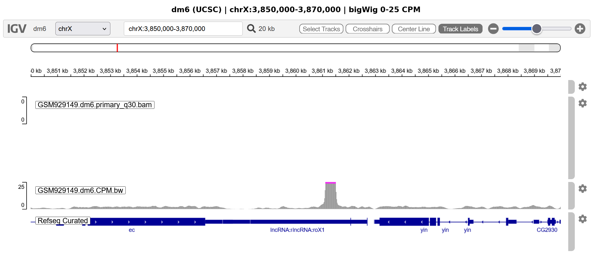

# Task 01 Report: MSL2 ChIP-seq Signal Processing & IGV Inspection (`GSM929149`)

## 1. Biological Context & Experimental Design
In *Drosophila melanogaster*, sex-chromosome dosage compensation equalizes X-linked gene expression between XY males and XX females by hypertranscribing the single male X chromosome approximately twofold. This transcriptional upregulation is mediated by the Male-Specific Lethal (MSL) ribonucleoprotein complex, in which **MSL2** serves as the essential male-specific DNA-binding core subunit that nucleates complex assembly at high-affinity **Chromatin Entry Sites (CES)** (such as the X-linked non-coding RNA locus *roX1*) and spreads *in cis* across active X-chromosomal genes (such as *Act5C*), while sparing autosomes (such as *RpL32*).

Dataset **`GSE37864` / `GSM929149`** (Straub *et al.*, 2013, *Genome Research* 23:473–485) profiles endogenous MSL2 occupancy via ChIP-seq in male-derived *Drosophila* **S2** cells using a polyclonal anti-MSL2 antibody. Examining a single biological replicate (`msl2_2`, run `SRR495368`) on the UCSC `dm6` assembly establishes baseline signal-to-noise behavior, alignment behavior, and expected X-versus-autosome patterns before multi-replicate peak calling and input normalization.

## 2. Dataset & Reference Provenance
- **Study / Sample:** GEO `GSE37864` / `GSM929149` (SRA `SRX146994` / `SRR495368`, biological replicate `msl2_2`), MSL2 ChIP-seq in *Drosophila melanogaster* male S2 cells (rabbit polyclonal anti-MSL2 serum; Illumina Genome Analyzer II, single-end 36 bp, 59,200,042 spots).
- **Primary Reference:** Straub T, Zabel A, Gilfillan GD, Feller C, Becker PB (2013), *Genome Research* 23:473–485 (`GSE37864`, doi:10.1101/gr.146407.112).
- **SRA Archive & FASTQ Verification:** Local SRA archive `data/raw/SRR495368/SRR495368.sra` verified consistent via `vdb-validate` (`logs/task_01/vdb_validate.SRR495368.log`). Deterministic reconversion via `fasterq-dump` (`logs/task_01/fasterq_dump.SRR495368.log`) matched the uncompressed MD5 of `data/raw/SRR495368.fastq.gz` (`ca17f2bdfb248389cf0aaf9bb455550d`, `logs/task_01/fastq_reconversion_check.txt`); compressed archive MD5 `c5ed574ae121cd8620d078ca5cc0f6bc` (`logs/task_01/SRR495368.fastq.md5`), 59,200,042 reads, uniform 36 bp read length (`logs/task_01/fastq_check.SRR495368.tsv`).
- **Reference Genome (`dm6`):** UCSC `dm6.fa.gz`, archive MD5 `4a5777324403eff92c3650c30af30120` verified against UCSC `md5sum.txt` (`dm6.fa.gz: OK` in `logs/task_01/dm6.fa.gz.md5check.txt`); uncompressed `dm6.fa` MD5 `5aadf7ccab5a6b674e76516bf75eaa09` (`logs/task_01/dm6.fa.md5`).

## 3. Software & Reproducibility
Orchestrated dynamically from `metadata/samples.tsv` via `scripts/run_all.sh` (`01_download.sh`–`04_coverage.sh` and `05_annotate_igv_figures.py`) in Conda environment `msl2-chipseq` (`environment.yml`, pinned `environment.lock.txt`). Versions recorded in `logs/task_01/software_versions.txt`:
- `curl`: `8.23.0` | `Python`: `3.13.18` | `Pillow`: `13.0.0` | `pyBigWig`: `0.3.29` | `fasterq-dump`: `3.4.1` | `fastqc`: `v0.13.0` | `multiqc`: `1.35` | `bowtie2`: `2.5.5` | `samtools`: `1.24` | `bamCoverage` (deepTools): `4.0.0` | `IGV-Web`: `2.4.10` (`igv.js` `3.8.8`)

## 4. Alignment, Filtering & Duplicate Retention Rationale
Single-end 36 bp reads were aligned to `dm6` with `bowtie2 -p 4` (`logs/task_01/bowtie2.GSM929149.log`). Default end-to-end (`--sensitive`) alignment was chosen rather than local soft-clipping because Illumina GAII 36 bp ChIP-seq reads lack adapters at 3' ends and short 36-mers benefit from full-length seed-and-extend scoring to minimize spurious partial hits. Without `-k`, Bowtie2 reports one alignment per read; when several genomic locations score equally, one is chosen at random and assigned `MAPQ = 0` or `1`, so subsequent `MAPQ >= 30` filtering removes those ambiguous alignments:
- **Total raw input reads:** 59,200,042 (100.00% of raw)
- **Aligned 0 times (unaligned):** 16,909,465 (28.56% of raw)
- **Aligned >= 1 time (overall mapped):** 42,290,577 (71.44% of raw; 32,585,348 [55.04% of raw] aligned once and 9,705,229 [16.39% of raw] aligned >1 time)

Alignments were coordinate-sorted (`GSM929149.dm6.sorted.bam`) and filtered with `samtools view -F 0x904 -q 30` (`GSM929149.dm6.primary_q30.bam`), retaining **32,530,464** primary reads with `MAPQ >= 30` (**54.95%** of raw input reads; **76.92%** of mapped reads; verified via `samtools quickcheck` in `logs/task_01/bam_integrity.txt`). The filter removed **9,760,113** mapped reads (16.49% of raw input), mostly reads with several equally good locations; it reduces but does not eliminate mapping ambiguity, and does not prove that each retained read has a unique genomic origin.

**Duplication Summary:** FastQC estimates **19.49%** duplicated sequences in the raw reads (sequence-based; 80.51% remaining after deduplication, module status `PASS`). On the filtered primary BAM, `samtools markdup -s` (`results/task_01/qc/GSM929149.dm6.primary_q30.markdup_stats.txt`) identified **8,281,791** position-based duplicate single-end reads (**25.46%** of the 32,530,464 retained reads). As required by the task for this initial coverage track—and because authentic focal binding at high-affinity sites like *roX1* produces identical 5' read starts on 36 bp libraries—duplicates were **retained** (`GSM929149.dm6.primary_q30.bam` has no duplicate flags set) so narrow CES summits are not truncated.

## 5. FastQC, MultiQC & Unmapped Read Investigation (`28.56%`)
FastQC inspection of raw reads (`results/task_01/qc/SRR495368_fastqc.html`), unmapped reads (`results/task_01/qc/SRR495368.unmapped_fastqc.html`), and the aggregated MultiQC report (`results/task_01/qc/multiqc_report.html`) summarizes read counts across all four processing stages:

| Processing Stage / QC Metric | Read Count / Value | Denominator / Reference | Interpretation |
| :--- | :--- | :--- | :--- |
| **1. Raw sequences (`SRR495368`)** | 59,200,042 (100.00%, 36 bp) | Raw SRA spots (`59,200,042`) | Matches SRA metadata (`n_spots = 59,200,042`) exactly |
| **2. Reads after trimming** | 59,200,042 (100.00% of raw) | Raw input reads (`59,200,042`) | No trimming applied: Q2 reads span all 36 bp and cannot be rescued |
| **3. Mapped reads (`Bowtie2`, >= 1 hit)** | 42,290,577 (71.44% of raw) | Raw input reads (`59,200,042`) | 55.04% aligned once; 16.39% aligned >1 time; 28.56% unaligned |
| **4. Retained primary reads (`MAPQ >= 30`)** | 32,530,464 (54.95% of raw; 76.92% of mapped) | Raw (`59,200,042`) / Mapped (`42,290,577`) | High-confidence primary alignments retained for coverage (MAPQ is not proof of uniqueness) |
| Raw GC Content / Adapter Content | 48% GC / <0.03% adapter | Raw input reads (`59,200,042`) | FastQC `%GC = 48`; negligible adapter carryover |
| Quality-2 (`Q = 2`) Reads from Cycle 1 | ~30% of raw reads | Raw input reads (`59,200,042`) | Reads flagged with the Illumina quality-2 indicator (read-segment quality control) from cycle 1 (`#` across all 36 bp) |
| Unmapped Reads (`16,909,465`, 28.56% of raw) | Median `Q = 2` + 100,423 all-`N` | Unaligned reads (`16,909,465`) | Low-confidence base calls across full read; trimming cannot rescue |
| Duplication (FastQC vs. `samtools markdup`) | 19.49% raw / 25.46% retained | Raw (`59,200,042`) / Retained (`32,530,464`) | Sequence-based (FastQC) vs. position-based (`markdup`); retained per task specification |

## 6. Chromosome-Level Alignment Breakdown (`MAPQ >= 30`)
From `results/task_01/qc/GSM929149.dm6.primary_q30.idxstats.txt` (total filtered primary reads = **32,530,464**):

| Chromosome | Length (bp) | Filtered Reads (`MAPQ >= 30`) | Density (reads/Mb) | Density / Major Autosomes |
| :--- | ---: | ---: | ---: | ---: |
| `chr2L` | 23,513,712 | 6,618,264 | 281,464 | 1.11 |
| `chr2R` | 25,286,936 | 6,164,115 | 243,767 | 0.96 |
| `chr3L` | 28,110,227 | 6,571,323 | 233,770 | 0.92 |
| `chr3R` | 32,079,331 | 8,340,542 | 259,997 | 1.02 |
| `chrX` | 23,542,271 | 4,494,154 | 190,897 | 0.75 |
| `chr4` | 1,348,131 | 222,131 | 164,770 | 0.65 |
| `chrY` | 3,667,352 | 6,891 | 1,879 | 0.01 |
| `chrM` | 19,524 | 18,404 | 942,635 | 3.71 |

In male S2 cells (`~2X;4A` aneuploid karyotype), roughly half the autosomal read density (`~0.50`) would be expected on `chrX` in the absence of specific binding; the observed `chrX` / major-autosome density ratio is **0.75** (`190,897` vs. `254,098` reads/Mb). This elevation is compatible with relative X enrichment driven by focal MSL2 binding, though copy-number variation, mappability, and background cannot be separated without an input control.

## 7. Normalized Coverage Track & Quantitative `pyBigWig` Verification
A 10 bp binned, 150 bp read-extended, CPM-normalized bigWig track (`results/task_01/tracks/GSM929149.dm6.CPM.bw`) was generated with `bamCoverage` (`logs/task_01/bamCoverage.GSM929149.log`; 1 CPM = 32.53 extended fragments). Window maxima and means were extracted programmatically with `pyBigWig` (`logs/task_01/GSM929149.bigwig_maxima.tsv`):

| Locus | Genomic Coordinates (`dm6`) | Peak Summit (`max_CPM`) | Window Mean (`mean_CPM`) | Selection Rationale |
| :--- | :--- | ---: | ---: | :--- |
| `roX1` | `chrX:3,850,000-3,870,000` | **228.22** | 4.220 | Known high-affinity X-linked Chromatin Entry Site (CES) |
| `Act5C` | `chrX:5,893,000-5,913,000` | **30.37** | 2.011 | Highly expressed X-linked housekeeping gene |
| `RpL32` | `chr3R:30,035,000-30,055,000` | **4.73** | 2.274 | Highly expressed autosomal comparison gene |

## 8. IGV Visual Inspection (Fixed bigWig Scale `[0 - 25]` CPM)
All three loci were inspected in IGV on `dm6` with assembly/coordinate banners, track labels visible, a fixed y-axis scale of `[0 - 25]` CPM on `GSM929149.dm6.CPM.bw`, and the `Refseq Curated` gene track displayed below. Note that the raw BAM coverage histograms are autoscaled independently across panels (maxima 2,179, 437, and 49 reads, respectively), so only the fixed `[0 - 25]` CPM bigWig track is directly comparable across figures:

1. **X-Linked High-Affinity Entry Site — `roX1` (`chrX:3,850,000-3,870,000`):** 
   *Figure 1. IGV-Web, `dm6`, `chrX:3,850,000-3,870,000`; tracks: `GSM929149.dm6.primary_q30.bam` (autoscaled, max 2,179), `GSM929149.dm6.CPM.bw` (`[0 - 25]` CPM), `Refseq Curated`.*
   A sharp local maximum (`228.22` CPM, clipping above the `[0 - 25]` display range) lies within `roX1`, consistent with strong MSL2 recruitment to the `roX1` Chromatin Entry Site.
2. **X-Linked Active Gene — `Act5C` (`chrX:5,893,000-5,913,000`):** 
   *Figure 2. IGV-Web, `dm6`, `chrX:5,893,000-5,913,000`; tracks: `GSM929149.dm6.primary_q30.bam` (autoscaled, max 437), `GSM929149.dm6.CPM.bw` (`[0 - 25]` CPM), `Refseq Curated`.*
   A focal maximum (`30.37` CPM) appears in the 3' region of `CG12236`, about 0.8 kb from `Shmt` (which starts 67 bp beyond the right edge of the window) and adjacent to `Act5C`, consistent with the reported association of the MSL complex with active X-linked genes; this single ChIP track alone cannot establish enrichment without an input control.
3. **Autosomal Comparison Region — `RpL32` (`chr3R:30,035,000-30,055,000`):** 
   *Figure 3. IGV-Web, `dm6`, `chr3R:30,035,000-30,055,000`; tracks: `GSM929149.dm6.primary_q30.bam` (autoscaled, max 49), `GSM929149.dm6.CPM.bw` (`[0 - 25]` CPM), `Refseq Curated`.*
   Signal stays well below the `[0 - 25]` CPM display ceiling (`max = 4.73` CPM) with no focal peak. The window mean (`2.27` CPM) is about twice the expected genome-wide mean (`~1.1` CPM) and similar to the `Act5C` window (`2.01` CPM); this single autosomal view cannot address X-chromosome specificity.

**Suspicious Features & IGV Visualization Artifacts (Hypotheses to Verify):**
- **Recurrent mismatch columns across many reads (Figures 1–3):** Vertical colored base-mismatch stripes appear consistently across stacked reads in all three panels, likely representing S2-cell-specific SNVs/indels relative to the `dm6` reference genome or systematic sequencing errors.
- **Local coverage gaps (`~3,858 kb` in Figure 1; `~30,043.5 kb` in Figure 3):** Sharp drops to zero coverage occur near the annotated transposable element `X{}1937` in Figure 1 and around `30,043.5 kb` in Figure 3, likely reflecting repetitive intervals excluded by the `MAPQ >= 30` filter or local deletions in S2 cells.
- **Secondary peak near the `CG12236` transcription start (`~5,908 kb`, Figure 2):** A secondary enrichment bump near the 5' end of `CG12236` may represent a promoter-associated open-chromatin artefact and should be checked against an input control.
- **Display-window artifacts:** Fixing the bigWig y-axis at `[0 - 25]` CPM intentionally clips the `roX1` summit (`228.22` CPM) so moderate signal at `Act5C` (`30.37` CPM) remains legible, while `Shmt` begins 67 bp past the right edge of Figure 2 (`chrX:5,913,000`).

## 9. Limitations, Problems Encountered, Open Questions & Next Checks
**Methodological Limitations:**
- **Single biological replicate & no input control:** Only replicate `msl2_2` (`GSM929149` / `SRR495368`) was processed here, and no matched IgG/input control was included in Task 01 (the public `GSE37864` series summary lists ChIP experiments for MSL1, MSL2, MSL3, MOF, MLE, H4K16ac, and RNA Pol II with 1–3 biological replicates per experiment without listing an input sample). Without an input control, absolute fold-enrichment cannot be quantified and promoter-associated false positives from the polyclonal serum cannot be excluded.
- **Short single-end reads (`36 bp`) & residual mapping ambiguity:** `28.56%` of reads did not align (predominantly quality-2 reads across all 36 bp). While `MAPQ >= 30` removes most multi-mapping alignments, it reduces rather than eliminates ambiguity in repetitive regions, and the 150 bp extension only approximates ChIP fragment length for visualization.
- **Retained duplicates (`25.46%`):** PCR/optical duplicates were kept as required for this initial track to preserve sharp CES summits, meaning local peak maxima may include PCR amplification duplicates.

**Problems Encountered During Analysis:**
- **NCBI SRA HTTPS download stalls:** Direct `prefetch` transfers stalled mid-stream on WSL2; resolved by retrieving the canonical SRA archive (`SRR495368.sra`) via NCBI's AWS S3 mirror with `curl -C - --retry 10` (`logs/task_01/download.SRR495368.log`), verifying archive integrity with `vdb-validate`, and confirming bit-identical `fasterq-dump` reconversion (`ca17f2bdfb248389cf0aaf9bb455550d`).
- **Missing ImageMagick binary for figure annotation:** `convert`/`magick` was unavailable in the base WSL image; resolved deterministically using Python `Pillow` (`PIL`) to stamp assembly (`dm6 (UCSC)`), genomic coordinates, and scale (`0-25 CPM`) banners onto all three IGV figures.

**Open Questions:**
1. To what extent does the observed `chrX` / major-autosome read-density ratio (`0.75`) reflect genuine MSL2 enrichment versus S2 aneuploid copy-number variation (`~2X;4A`) or chromosomal mappability differences?
2. Is the 150 bp read-extension parameter optimal for this GAII ChIP library's true fragment-size distribution (as estimated by strand cross-correlation)?
3. What proportion of the `25.46%` position-based duplicates arises from genuine high-occupancy MSL2 binding at CES versus PCR over-amplification?

**Next Logical Checks:**
1. **Input Control Normalization:** Process the input control provided for the next task and compute `log2(ChIP / Input)` tracks (`bamCompare`) to separate true MSL2 binding from S2 copy-number variation and open-chromatin sonication bias.
2. **Replicate Concordance:** Process the remaining MSL2 biological replicates from `GSE37864` and evaluate genome-wide correlation (`multiBigwigSummary` / `plotCorrelation`) and irreproducible discovery rate (IDR).
3. **Peak Calling & Motif Discovery:** Call narrow peaks with `macs2 callpeak --nomodel --extsize 150 -g dm` against the input control, quantify X-chromosome peak enrichment, and run `MEME`/`FIMO` to verify enrichment of the GA-rich MSL Recognition Element (MRE) motif beneath summits.

## 10. File Manifest & Checksums
| Artifact | Size | MD5 | Status |
| :--- | ---: | :--- | :--- |
| `logs/task_01/software_versions.txt` | 347 B | `8076300eaa609543a9a42d4b3d75a00e` | Tracked |
| `logs/task_01/download.SRR495368.log` | 359 B | `febd0f172f2747186fd7568760529634` | Tracked |
| `logs/task_01/vdb_validate.SRR495368.log` | 500 B | `51c4decc148a0621d7f5641c726fb44d` | Tracked |
| `logs/task_01/fastq_reconversion_check.txt` | 92 B | `0e709715a4cdeec1a4be077d0b59fbb4` | Tracked |
| `logs/task_01/SRR495368.fastq.md5` | 62 B | `4fbfee4f48d0b0bcc0fe9d8ad7123722` | Tracked |
| `logs/task_01/fastq_check.SRR495368.tsv` | 31 B | `18125ad1fa15b0fcffb530a6db74560f` | Tracked |
| `logs/task_01/dm6.fa.gz.md5check.txt` | 14 B | `ffba134b988f3d6a2f3a52d0a6082f58` | Tracked |
| `logs/task_01/bowtie2.GSM929149.log` | 223 B | `a2abe58352aaf9952fa631b5b8e8ff58` | Tracked |
| `logs/task_01/bamCoverage.GSM929149.log` | 350 B | `616b392d7e26c92b1fef6d92260c6a18` | Tracked |
| `logs/task_01/GSM929149.bigwig_maxima.tsv` | 149 B | `1a6ab27c53ca7a1ebfd260e17887b638` | Tracked |
| `logs/task_01/local_files_manifest.md` | 2.6 KB | `7e3dbf8598334b9fd2fcd5144ece199b` | Tracked |
| `results/task_01/qc/multiqc_report.html` | 2.4 MB | `108446df7626244351258d4fc77db6f7` | Tracked |
| `reports/task_01/igv/fig1_session.json` | 1.7 KB | `2e2b0fb6621f4bec7c1eb00fb20984d8a46da9466a9637c09756c6c065862613` | Tracked |
| `reports/task_01/igv/fig2_session.json` | 1.7 KB | `c9981d8278258844ae7732531f67045bc4ea26c3cfabab3beb1b264345975d56` | Tracked |
| `reports/task_01/igv/fig3_session.json` | 1.7 KB | `09170fd3c044f26edd393af8ee8e034418a0a5aa4cf1f13a18968dcdd38b4c29` | Tracked |
| `reports/task_01/figures/raw/fig1_roX1_CES_raw.png` | 99.7 KB | `7ad4db520f349e862aa56aeb14cf929c2810e9da2297f67d3e13f2477a43f7ec` | Tracked |
| `reports/task_01/figures/raw/fig2_Act5C_X_gene_raw.png` | 105.1 KB | `238d722f96958acbcc6e6413f83366b74cc50f34d19fd6a7aab3401fded843d7` | Tracked |
| `reports/task_01/figures/raw/fig3_RpL32_autosomal_control_raw.png` | 100.5 KB | `1886b93fa839dd2721f0b188b7a736630b3dbc330b8738d5759236a0ab7afdaf` | Tracked |
| `reports/task_01/figures/fig1_roX1_CES.png` | 116.1 KB | `f4361ff19478b4f1c51b39354d8e158c590279231d7ae7c84488ef97d4a0e88e` | Tracked |
| `reports/task_01/figures/fig2_Act5C_X_gene.png` | 121.1 KB | `53c39d2598008ee5b4c3a7b04921bca159e53546d081ee393d45c061488c0597` | Tracked |
| `reports/task_01/figures/fig3_RpL32_autosomal_control.png` | 112.4 KB | `7ffb66d3d9e71acd313b21711f14c4da6cc00b2984b8d15f909c545ff819111d` | Tracked |
| `data/raw/SRR495368/SRR495368.sra` | 1.18 GB | `1d4abf2ed5f809f8486e1f651cfb2221` | Ignored (local SRA archive) |
| `data/raw/SRR495368.fastq.gz` | 2.15 GB | `c5ed574ae121cd8620d078ca5cc0f6bc` | Ignored (raw FASTQ) |
| `results/task_01/bam/GSM929149.dm6.sorted.bam` | 1.63 GB | `4c803d1cbc4e16db235b0487f1dd2541` | Ignored (coordinate-sorted BAM) |
| `results/task_01/bam/GSM929149.dm6.primary_q30.bam` | 1.05 GB | `a97e9495c59b64a46e1d985a4903a662` | Ignored (filtered primary MAPQ >= 30 BAM) |
| `results/task_01/tracks/GSM929149.dm6.CPM.bw` | 61.0 MB | `6bc430c3979e6f8ab19b6f06385ae04d` | Ignored (CPM-normalized bigWig track) |
