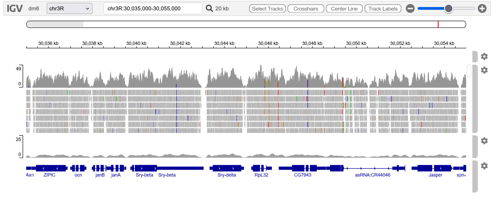

# MSL2 ChIP-seq Analysis in *Drosophila melanogaster* S2 Cells (`dm6`)

## 1. Dataset & Experimental Context
- **GEO / SRA Accession:** `GSE37864` / `GSM929149` / `SRX146994` / `SRR495368`
- **Target Protein & Antibody:** Male-Specific Lethal 2 (MSL2), core DNA-binding subunit of the Dosage Compensation Complex (DCC / MSL complex), immunoprecipitated with **rabbit polyclonal anti-MSL2 serum** (native endogenous MSL2; no epitope tag).
- **Biological Model:** *Drosophila melanogaster* Schneider 2 (S2) embryonic cell line (male-like dosage compensation state; aneuploid karyotype ~2X;4A).
- **Reference Assembly:** UCSC `dm6` (BDGP Release 6 + ISO1 MT; 1,870 sequences).
- **Library Layout:** Single-end Illumina Genome Analyzer II sequencing (`36 bp` read length; `59,200,042` raw reads).

---

## 2. Reproducible Pipeline Architecture
All processing steps are modularized into four Bash scripts under `scripts/` and executed inside the `msl2-chipseq` Conda environment (`environment.yml`, locked in `environment.lock.txt`):
1. `scripts/01_download.sh`: Downloads `SRR495368` via SRA Toolkit, validates archive integrity (`vdb-validate` and MD5), verifies exact read count (`59,200,042`) and length (`36 bp`), and downloads/verifies/indexes UCSC `dm6.fa.gz`.
2. `scripts/02_fastq_qc.sh`: Runs `FastQC` on `SRR495368.fastq.gz` (`results/task_01/qc/SRR495368_fastqc.html`).
3. `scripts/03_align_and_filter.sh`: Aligns single-end reads to `dm6` via `bowtie2`, coordinate-sorts and indexes (`samtools sort`, `samtools index`, `samtools quickcheck`), inspects unmapped reads via `FastQC` (`results/task_01/qc/SRR495368.unmapped_fastqc.html`), filters for primary alignments with `MAPQ >= 30` (`samtools view -F 0x904 -q 30`), measures PCR duplicates without removal (`samtools markdup`), and aggregates metrics into `results/task_01/qc/multiqc_report.html`.
4. `scripts/04_coverage.sh`: Generates CPM-normalized coverage tracks (`GSM929149.dm6.CPM.bw`) using `deepTools bamCoverage` (`--binSize 10 --normalizeUsing CPM --extendReads 150`).

---

## 3. Quality Control & Read-Processing Summary

### Raw & Unaligned Read QC (`FastQC` / `MultiQC` / `samtools stats`)
- **Read Length & Base Composition:** All `59,200,042` raw reads have a uniform length of `36 bp`, with a mean GC content of `48.2%` and negligible ambiguous (`N`) base calls.
- **Illumina Q2 Quality Tails (`35.90%` of bases):** `samtools stats` shows that `35.90%` of all sequenced bases carry Phred score `2` (`#` in ASCII+33). On Illumina Genome Analyzer II instruments, `Q=2` is the standard Read Segment Quality Control Indicator marking low-confidence 3′ read ends. FastQC on the `16,909,465` unaligned reads (`SRR495368.unmapped_fastqc.html`) confirms that these reads are heavily enriched for 3′ `Q=2` tails and base-calling errors rather than adapter contamination.
- **Justification for No Trimming:** Reads were aligned untrimmed (`59,200,042` reads retained) because `36 bp` reads already sit near Bowtie2's short-read uniqueness threshold; 3′ quality trimming would shorten reads below `25–30 bp`, sharply increasing multi-mapping ambiguity across repetitive elements without rescuing true unique alignments.
- **PCR Duplicate Rate (`samtools markdup`):** Within the `32,530,464` filtered primary reads (`MAPQ >= 30`), `samtools markdup` identified **`8,281,791` duplicate reads (`25.46%` of retained reads)**. In accordance with the workflow specification, **all marked duplicates were retained** in `GSM929149.dm6.primary_q30.bam` and `GSM929149.dm6.CPM.bw` rather than removed.

### Read Accounting Across Pipeline Stages

| Processing Stage | Read Count | % of Raw Reads | Notes |
| :--- | ---: | ---: | :--- |
| **Raw Sequenced Reads (`SRR495368`)** | `59,200,042` | `100.00%` | Single-end `36 bp` (`FastQC` / `samtools stats`) |
| **Post-Trimming Reads** | `59,200,042` | `100.00%` | No trimming applied (see QC justification above) |
| **Aligned Primary Reads** | `42,290,577` | `71.44%` | Bowtie2 `--end-to-end` primary alignments |
| **Unaligned Reads (`FLAG 0x4`)** | `16,909,465` | `28.56%` | Driven largely by 3′ Illumina `Q=2` quality tails |
| **Excluded Low-MAPQ Reads (`MAPQ < 30`)** | `9,760,113` | `16.49%` | Multi-mapping / low-confidence alignments removed (`-q 30`) |
| **Retained Filtered Reads (`MAPQ >= 30`)** | `32,530,464` | `54.95%` | Primary alignments (`-F 0x904 -q 30`) used for bigWig |
| **Marked PCR Duplicates (Retained)** | `8,281,791` | `13.99%` (`25.46%` of retained) | Measured via `samtools markdup`; **kept** in BAM & bigWig |

### Per-Chromosome Read Distribution (`samtools idxstats`, `MAPQ >= 30`)

| Chromosome | Length (bp) | Mapped Reads (`MAPQ >= 30`) | Share of Retained (%) | Karyotype / Biological Context |
| :--- | ---: | ---: | ---: | :--- |
| **`chrX`** | `23,542,271` | `4,494,154` | `13.82%` | Target chromosome of MSL2 / DCC (~2X in S2) |
| **`chr2L`** | `23,513,712` | `6,618,264` | `20.34%` | Autosomal arm (~4A in S2) |
| **`chr3R`** | `32,079,331` | `8,340,542` | `25.64%` | Autosomal arm (~4A in S2) |
| **`chr4`** | `1,348,131` | `222,131` | `0.68%` | Dot chromosome |
| **`chrM`** | `19,524` | `18,684` | `0.06%` | Mitochondrial genome |

*Note on S2 Aneuploidy:* Because S2 cells carry roughly half as many X chromosomes as major autosomes (~2X;4A), the bulk X-chromosome read share (`13.82%`) reflects lower baseline DNA copy number offset by strong focal enrichment at Chromatin Entry Sites (CES) and active X-linked gene bodies.

---

## 4. IGV Visual Verification & Coverage Track Interpretation

### Coverage Track Definition (`GSM929149.dm6.CPM.bw`)
Each bin value in `GSM929149.dm6.CPM.bw` represents the count of **150 bp 3′-extended primary reads (`MAPQ >= 30`, PCR duplicates retained)** overlapping a **10 bp genomic bin**, normalized to Counts Per Million mapped reads ($\text{CPM} = \text{bin overlap count} \times 10^6 / 32,530,464$). Thus, **1 CPM corresponds to ~32.53 overlapping extended fragments**. All three IGV views display `20 kb` windows on `dm6` with the bigWig track fixed to a **`0–25 CPM`** display ceiling so baseline background across loci can be compared directly; peaks exceeding `25 CPM` are visually clipped at the top of the track, and their exact unclipped maxima (queried via `pyBigWig`) are reported below.

### Figure 1: Canonical Chromatin Entry Site — *roX1* (`chrX:3,850,000-3,870,000`)

- **Observation:** A sharp focal MSL2 signal peaking at **`228.22 CPM`** (exceeding the `25 CPM` visual display ceiling) centers directly over the internal DHS/CES enhancer within `lncRNA:roX1`, consistent with strong recruitment of the dosage compensation complex to its primary X-linked nucleation site.

### Figure 2: Active X-Linked Dosage-Compensated Locus — *Act5C* (`chrX:5,893,000-5,913,000`)

- **Observation:** Broad moderate coverage across the *Act5C* transcription unit is accompanied by a focal peak reaching **`30.37 CPM`** (slightly above the `25 CPM` display ceiling) downstream near `CG12236` / `Shmt` (truncated to `"Sh"` in the IGV annotation track), illustrating MSL2 enrichment across active X-linked chromatin domains.

### Figure 3: Autosomal Negative Control — *RpL32* (`chr3R:30,035,000-30,055,000`)

- **Observation:** Across the constitutively transcribed autosomal ribosomal protein gene *RpL32* on `chr3R`, the track remains at low baseline background (local window maximum **`4.73 CPM`**, mostly `< 2 CPM`) with no focal peaks, consistent with preferential X-chromosome association of MSL2 relative to autosomal housekeeping genes.

---

## 5. Limitations
- **Absence of Matched Input / IgG Control:** Because only the anti-MSL2 ChIP library (`GSM929149`) was analyzed without a matched input DNA or pre-immune serum control, open-chromatin accessibility and S2 copy-number biases cannot be normalized out; formal peak calling (`MACS2`/`MACS3`) was therefore omitted, and inspecting three loci in a single ChIP track cannot establish genome-wide binding specificity.
- **Single SRA Run Without Biological Replicates:** Analysis is based on a single SRA run (`SRR495368` / `GSM929149`) without independent biological replicates, precluding irreproducible discovery rate (IDR) or replicate concordance testing.
- **Short Single-End Reads (`36 bp`) & Quality Tails:** Short single-end sequencing with 3′ Illumina `Q=2` quality tails limits mappability in repetitive regions (`28.56%` unaligned), mitigated here by filtering for `MAPQ >= 30` and extending reads to `150 bp` during bigWig generation.
- **S2 Cell Line Aneuploidy (~2X;4A):** S2 cells possess a male-like aneuploid karyotype with ~2 X chromosomes per 4 sets of autosomes, reducing baseline X-linked DNA template copy number by roughly twofold relative to autosomes.

---

## 6. Deliverable File Manifest

| File Path | Size (`du -h`) | MD5 Checksum | Git Status |
| :--- | ---: | :--- | :--- |
| `data/raw/SRR495368.fastq.gz` | `2.2G` | `c5ed574aa121cd0620d078ca5cc0f6bc` | Ignored (raw data) |
| `results/task_01/bam/GSM929149.dm6.sorted.bam` | `1.7G` | `41aa20dc2fd36466be7aad0a56e0136a` | Ignored (binary BAM) |
| `results/task_01/bam/GSM929149.dm6.sorted.bam.bai` | `532K` | `af10f779edd949f0721ffbf514449eb5` | Ignored (BAM index) |
| `results/task_01/bam/GSM929149.dm6.primary_q30.bam` | `1.1G` | `37ad797e87d4357dee68622f003a3e7e` | Ignored (binary BAM) |
| `results/task_01/bam/GSM929149.dm6.primary_q30.bam.bai` | `460K` | `3098f0868f8db0be7d56a0cfb5841780` | Ignored (BAM index) |
| `results/task_01/tracks/GSM929149.dm6.CPM.bw` | `62M` | `6bc430c3979e6f8ab19b6f06385ee04d` | Ignored (binary bigWig) |
| `results/task_01/qc/SRR495368_fastqc.html` | `228K` | Tracked in Git | Versioned |
| `results/task_01/qc/SRR495368.unmapped_fastqc.html` | `144K` | Tracked in Git | Versioned |
| `results/task_01/qc/multiqc_report.html` | `2.4M` | Tracked in Git | Versioned |
