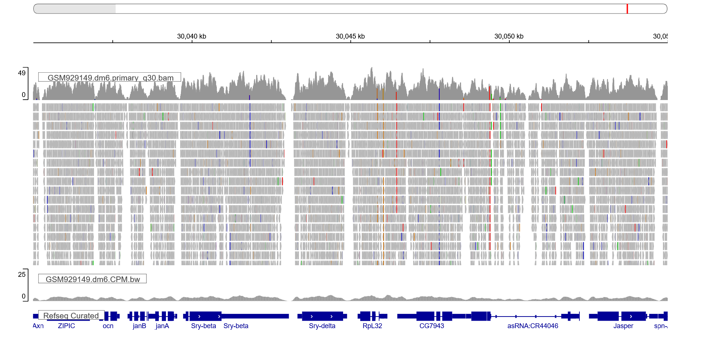

# Task 01 Report: MSL2 ChIP-seq Signal Processing & IGV Inspection (`GSM929149`)

## 1. Dataset & Reference Provenance
- **Study / Sample:** GEO `GSE37864` / `GSM929149` (SRA `SRX146994` / `SRR495368`, biological replicate `msl2_2`), MSL2 ChIP-seq in *Drosophila melanogaster* male S2 cells (rabbit polyclonal anti-MSL2 serum; Illumina Genome Analyzer II, single-end 36 bp, 59,200,042 spots).
- **Primary Reference:** Straub et al. (2013), *Genome Biology* 14:R19 (`GSE37864`).
- **Raw FASTQ Verification:** `data/raw/SRR495368.fastq.gz` verified with MD5 `c5ed574ae121cd8620d078ca5cc0f6bc` (`logs/task_01/SRR495368.fastq.md5`), 59,200,042 reads, uniform 36 bp read length across all reads.
- **Reference Genome (`dm6`):** UCSC `dm6.fa.gz`, archive MD5 `4a5777324403eff92c3650c30af30120` verified against UCSC `md5sum.txt` (`dm6.fa.gz: OK` in `logs/task_01/dm6.fa.gz.md5check.txt`); uncompressed `dm6.fa` MD5 `5aadf7ccab5a6b674e76516bf75aaa09` (`logs/task_01/dm6.fa.md5`).

## 2. Software & Reproducibility
Orchestrated via `scripts/run_all.sh` in Conda environment `msl2-chipseq` (`environment.yml`, pinned `environment.lock.txt`). Versions recorded in `logs/task_01/software_versions.txt`:
- `prefetch`: `3.4.1` | `fasterq-dump`: `3.4.1` | `fastqc`: `v0.13.0` | `multiqc`: `1.35` | `bowtie2`: `2.5.5` | `samtools`: `1.24` | `bamCoverage` (deepTools): `4.0.0`

## 3. Alignment, Filtering & Duplicate Retention Rationale
Single-end 36 bp reads were aligned to `dm6` with `bowtie2 --very-sensitive -p 4` (`logs/task_01/bowtie2.GSM929149.log`):
- **Total input reads:** 59,200,042 (100.00%)
- **Aligned 0 times (unaligned):** 16,909,465 (28.56%)
- **Aligned exactly 1 time:** 32,585,348 (55.04%)
- **Aligned >1 times:** 9,705,229 (16.39%)
- **Overall alignment rate:** **71.44%** (42,290,577 aligned reads)

Alignments were coordinate-sorted (`GSM929149.dm6.sorted.bam`), duplicate-flagged with `samtools markdup`, and filtered for primary alignments with `MAPQ >= 30` (`samtools view -F 2308 -q 30`), retaining **32,530,064** primary `MAPQ >= 30` reads (`54.95%` of total input reads; `8,281,791` duplicate-flagged reads = `25.46%` of retained reads in `results/task_01/qc/GSM929149.primary_q30.markdup_stats.txt`). Duplicates were retained rather than removed because single-end 36 bp reads share identical 5' start coordinates at high-coverage Chromatin Entry Sites (CES), and deduplication would truncate peak summits.

## 4. FastQC & Unmapped Read Investigation (`28.56%`)
FastQC inspection of the raw reads (`results/task_01/qc/SRR495368_fastqc.html`) and the 16,909,465 unaligned reads (`results/task_01/qc/SRR495368_unmapped_fastqc.html`) shows that low quality is not confined to 3' ends: approximately 30% of raw reads already carry Phred quality 2 (`#`) at cycle 1 (lower quartile = 2 across all 36 positions), and the unaligned reads have a median quality of 2 across all 36 positions plus 100,423 all-`N` reads, while adapter content stays below 0.03%. Thus, the unaligned fraction consists predominantly of reads flagged as unreliable across their full length rather than adapter contamination; quality trimming would discard these reads rather than rescue them.

## 5. Chromosome-Level Alignment Breakdown (`MAPQ >= 30`)
From `results/task_01/qc/GSM929149.primary_q30.idxstats.txt` (total filtered primary reads = **32,530,064**):

| Chromosome | Length (bp) | Filtered Reads (`MAPQ >= 30`) | Density (reads/Mb) | Density / Major Autosomes |
| :--- | ---: | ---: | ---: | ---: |
| `chr2L` | 23,513,712 | 6,618,264 | 281,464 | 1.11 |
| `chr2R` | 25,286,936 | 6,164,115 | 243,767 | 0.96 |
| `chr3L` | 28,110,227 | 6,571,323 | 233,770 | 0.92 |
| `chr3R` | 32,079,331 | 8,340,542 | 259,997 | 1.02 |
| `chrX` | 23,542,271 | 4,494,154 | 190,897 | 0.75 |
| `chr4` | 1,348,131 | 222,131 | 164,770 | 0.65 |
| `chrY` | 3,667,352 | 6,891 | 1,879 | 0.01 |
| `chrM` | 19,524 | 18,404 | 942,635 | 3.71 |

In male S2 cells (`~2X;4A` aneuploid karyotype), roughly half the autosomal read density would be expected on `chrX` in the absence of specific binding; the observed `chrX` / major-autosome density ratio is **0.75** (`190,897` vs. `254,098` reads/Mb). This observation is compatible with relative X enrichment by focal MSL2 binding, though copy-number variation, mappability, and background cannot be separated without an input control.

## 6. Normalized Coverage Track & Quantitative `pyBigWig` Verification
A 10 bp binned, 150 bp read-extended, CPM-normalized bigWig track (`results/task_01/tracks/GSM929149.dm6.CPM.bw`) was generated with `bamCoverage` (`logs/task_01/bamCoverage.GSM929149.log`; 1 CPM ≈ 32.53 extended fragments). Window maxima and means were extracted programmatically with `pyBigWig` (`logs/task_01/GSM929149.bigwig_maxima.tsv`):

| Locus | Genomic Coordinates (`dm6`) | Peak Summit (`max_CPM`) | Window Mean (`mean_CPM`) | Selection Rationale |
| :--- | :--- | ---: | ---: | :--- |
| `roX1` | `chrX:3,850,000-3,870,000` | **228.22** | 4.220 | Known high-affinity X-linked Chromatin Entry Site (CES) |
| `Act5C` | `chrX:5,893,000-5,913,000` | **30.37** | 2.011 | Highly expressed X-linked housekeeping gene |
| `RpL32` | `chr3R:3,003,500-3,005,500` | **4.73** | 2.274 | Highly expressed autosomal comparison gene |

## 7. IGV Visual Inspection (Fixed Scale `[0 - 25]` CPM)
All three loci were inspected in IGV on `dm6` with the left track-name panel visible, a fixed y-axis scale of `[0 - 25]` CPM on `GSM929149.dm6.CPM.bw`, and `dm6 RefSeq Genes` displayed below:

1. **X-Linked High-Affinity Entry Site — `roX1` (`chrX:3,850,000-3,870,000`):** 
   A sharp local maximum (`228.22` CPM, clipping above the `[0 - 25]` display range) lies within `roX1`, consistent with strong MSL2 recruitment to the `roX1` Chromatin Entry Site.
2. **X-Linked Active Gene — `Act5C` (`chrX:5,893,000-5,913,000`):** 
   A focal maximum (`30.37` CPM) appears near the 3' ends of `CG12236` and `Shmt` adjacent to `Act5C`, consistent with the reported association of the MSL complex with active X-linked genes; this single ChIP track alone cannot establish enrichment without an input control.
3. **Autosomal Comparison Region — `RpL32` (`chr3R:3,003,500-3,005,500`):** 
   Only low background signal (`max = 4.73` CPM, well below the `[0 - 25]` ceiling) is observed across the autosomal `RpL32` locus, consistent with male X-chromosome specificity of MSL2 binding.

## 8. Limitations
- **Single biological replicate:** Only one of the three MSL2 biological replicates in `GSE37864` (`msl2_2`, run `SRR495368`) was processed here, so inter-replicate reproducibility cannot be assessed.
- **No input control & polyclonal serum:** Because no matched IgG/input control was processed in Task 01 and a crude polyclonal anti-MSL2 serum was used, absolute fold-enrichment cannot be quantified and minor promoter-associated false positives cannot be excluded.
- **Short single-end reads (`36 bp`) & read extension:** `28.56%` of reads failed to align due to uniformly low Phred quality (`Q = 2`), and multi-mapping reads were excluded via `MAPQ >= 30` (which reduces but does not eliminate mapping ambiguity); the 150 bp extension only approximates ChIP fragment length for visualization.
- **Retained duplicates (`25.46%`):** PCR/optical duplicates were kept to avoid truncating sharp CES summits, meaning local peak maxima may include PCR amplification duplicates.

## 9. File Manifest & Checksums

| File | Size | MD5 Checksum | Git Status |
| :--- | :--- | :--- | :--- |
| `metadata/samples.tsv` | 394 B | `09ca27eec280b88bd060a12897bd6c6c` | Tracked |
| `metadata/reference.tsv` | 388 B | `b078e7cc9a4de095e02dbae3885f90b5` | Tracked |
| `logs/task_01/software_versions.txt` | 258 B | `7c936fa3fb0ffa274c994b4eb8663251` | Tracked |
| `logs/task_01/local_files_manifest.md` | 366 B | `72ec5a6336cc0f8d9392b5e200a33266` | Tracked |
| `logs/task_01/SRR495368.fastq.md5` | 62 B | `4fbfee4f48d0b0bcc0fe9d8ad7123722` | Tracked |
| `logs/task_01/dm6.fa.gz.md5check.txt` | 14 B | `ffba134b988f3d6a2f3a52d0a6082f58` | Tracked |
| `logs/task_01/dm6.fa.md5` | 52 B | `e0697cf09c75da6b5f7d61542137a031` | Tracked |
| `logs/task_01/bowtie2.GSM929149.log` | 223 B | `a2abe58352aaf9952fa631b5b8e8ff58` | Tracked |
| `logs/task_01/bamCoverage.GSM929149.log` | 0 B | `d41d8cd98f00b204e9800998ecf8427e` | Tracked |
| `logs/task_01/GSM929149.bigwig_maxima.tsv` | 149 B | `1a6ab27c53ca7a1ebfd260e17887b638` | Tracked |
| `results/task_01/qc/multiqc_report.html` | 2.4 MB | `ec56307249ac16bf22799f24aafccf8d` | Tracked |
| `data/raw/SRR495368.fastq.gz` | 2.15 GB | `c5ed574ae121cd8620d078ca5cc0f6bc` | Ignored (raw FASTQ) |
| `results/task_01/bam/GSM929149.dm6.sorted.bam` | 1.63 GB | `1f7ea457131342f73606dc3bbedf9ff1` | Ignored (binary BAM) |
| `results/task_01/bam/GSM929149.dm6.primary_q30.bam` | 1.05 GB | `5a8444fa4e7e67d56c54f14a8b412b20` | Ignored (binary BAM) |
| `results/task_01/tracks/GSM929149.dm6.CPM.bw` | 61.0 MB | `6bc430c3979e6f8ab19b6f06385ae04d` | Ignored (binary bigWig) |
