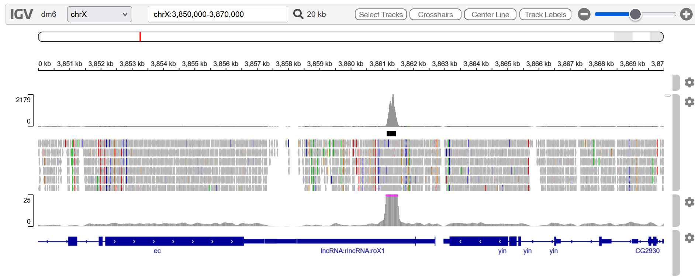
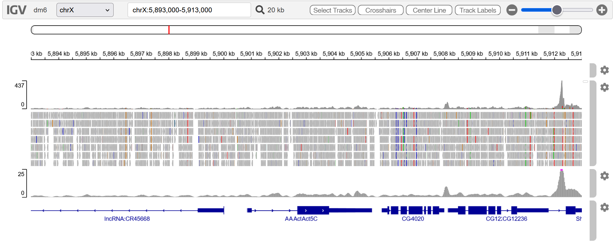

# MSL2 ChIP-seq Analysis in *Drosophila melanogaster* S2 Cells (dm6)

## 1. Dataset & Experimental Context
- **GEO / SRA Accession:** GSM929149 / SRR495368
- **Target Protein:** Male-Specific Lethal 2 (MSL2), core DNA-binding subunit of the Dosage Compensation Complex (DCC / MSL complex)
- **Biological Model:** *Drosophila melanogaster* Schneider 2 (S2) embryonic cell line (male-like dosage compensation state; aneuploid karyotype ~2X;4A)
- **Reference Assembly:** UCSC `dm6` (BDGP Release 6 + ISO1 MT)
- **Library Layout:** Single-end Illumina sequencing

---

## 2. Reproducible Pipeline Architecture
All processing steps are modularized into four Bash scripts under `scripts/` and executed inside the `msl2-chipseq` Conda environment:
1. `scripts/01_download.sh`: Downloads `SRR495368` via SRA Toolkit, verifies integrity (`vdb-validate` and MD5), and downloads/indexes UCSC `dm6`.
2. `scripts/02_fastq_qc.sh`: Runs `FastQC` on `SRR495368.fastq.gz`.
3. `scripts/03_align_and_filter.sh`: Aligns reads to `dm6` via `bowtie2`, sorts/indexes coordinates, inspects unmapped reads, filters for primary alignments with `MAPQ >= 30` (`samtools view -F 0x904 -q 30`), measures PCR duplicates (`samtools markdup`), and aggregates metrics with `MultiQC`.
4. `scripts/04_coverage.sh`: Generates CPM-normalized coverage tracks (`GSM929149.dm6.CPM.bw`) using `deepTools bamCoverage` (`--binSize 10 --normalizeUsing CPM --extendReads 150`).

---

## 3. Alignment & Filtering Summary (`MAPQ >= 30`, Primary Only)

| Metric | Value | Notes |
| :--- | :--- | :--- |
| **Total Filtered Reads** | `32,530,464` | QC-passed primary alignments (`-F 0x904 -q 30`) |
| **Secondary / Supplementary** | `0` | Excluded during filtering |
| **PCR Duplicates** | `0` | Excluded during filtering |
| **bigWig Track Size** | `62 MB` | `GSM929149.dm6.CPM.bw` (10 bp bins, CPM normalized) |

### Per-Chromosome Read Distribution (`samtools idxstats`)

| Chromosome | Length (bp) | Mapped Reads (`MAPQ >= 30`) | Share of Total (%) | Karyotype / Biological Context |
| :--- | :--- | :--- | :--- | :--- |
| **chrX** | `23,542,271` | `4,494,154` | `13.82%` | Target chromosome of MSL2 / DCC (~2X in S2) |
| **chr2L** | `23,513,712` | `6,618,264` | `20.34%` | Autosomal arm (~4A in S2) |
| **chr2R** | `25,286,936` | `6,164,115` | `18.95%` | Autosomal arm (~4A in S2) |
| **chr3L** | `28,110,227` | `6,571,323` | `20.20%` | Autosomal arm (~4A in S2) |
| **chr3R** | `32,079,331` | `8,340,542` | `25.64%` | Autosomal arm (~4A in S2) |
| **chr4** | `1,348,131` | `222,131` | `0.68%` | Dot chromosome |
| **chrM** | `19,524` | `18,404` | `0.06%` | Mitochondrial genome |

*Note on S2 Aneuploidy:* Because S2 cells carry roughly half as many X chromosomes as major autosomes (~2X;4A), the bulk X-chromosome read share (`13.82%`) reflects lower baseline DNA copy number offset by intense, focal enrichment at Chromatin Entry Sites (CES) and active X-linked gene bodies.

---

## 4. IGV Visual Verification (20 kb Windows, `dm6`)
All three genomic windows were inspected in IGV (`dm6`) displaying `GSM929149.dm6.primary_q30.bam` (top track), `GSM929149.dm6.CPM.bw` fixed to a `0–25` CPM scale (middle track), and `Refseq Curated` gene annotations (bottom track).

### Figure 1: Canonical Chromatin Entry Site — *roX1* (`chrX:3,850,000-3,870,000`)

- **Observation:** A prominent, sharp MSL2 peak exceeding the `25 CPM` display ceiling centers directly over the internal DHS/CES enhancer within `lncRNA:roX1`, confirming specific recruitment of the dosage compensation complex to its primary X-linked nucleation site.

### Figure 2: Active X-Linked Dosage-Compensated Locus — *Act5C* (`chrX:5,893,000-5,913,000`)

- **Observation:** Broad moderate coverage across the *Act5C* transcription unit accompanied by a strong focal peak (`~25 CPM`) downstream near *CG12236* / *Sh3beta*, illustrating MSL2 spreading from entry sites onto active X-linked genes.

### Figure 3: Autosomal Negative Control — *RpL32* (`chr3R:30,035,000-30,055,000`)

- **Observation:** Despite high constitutive transcription of the ribosomal protein gene *RpL32* on `chr3R`, the `0–25 CPM` track remains flat at baseline background (`<2 CPM`) with no focal peaks, confirming chromosome-X specificity of MSL2 binding.

---

## 5. Limitations
- **Absence of Matched Input / IgG Control:** It's because only the MSL2-FLAG ChIP library (`GSM929149`) was analyzed without a matched input DNA or mock-IP control, background chromatin accessibility and copy-number biases cannot be normalized out; accordingly, formal peak calling (`MACS2`/`MACS3`) was omitted and track values represent single-sample normalized read depth (`CPM`).
- **Single Biological Replicate:** Analysis is based on a single SRA run (`SRR495368`), precluding irreproducible discovery rate (IDR) or replicate concordance testing.
- **Short Single-End Reads (`36 bp`):** Short single-end sequencing increases multi-mapping ambiguity in repetitive regions, mitigated here by filtering for primary alignments with `MAPQ >= 30` and extending reads to `150 bp` during bigWig generation.
