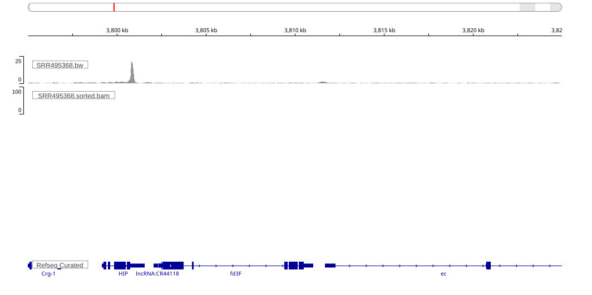
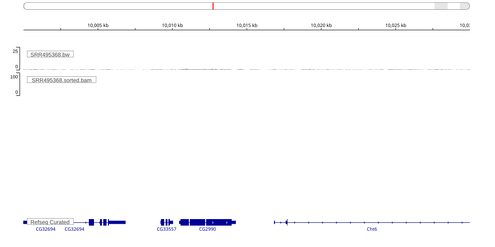

# Task 01 Report: MSL2 ChIP-seq Alignment, Coverage Track Generation & IGV Visualization (*Drosophila melanogaster*, dm6)

## 1. Objective & Biological Context
In *Drosophila melanogaster*, male-specific dosage compensation is mediated by the Male-Specific Lethal (MSL) ribonucleoprotein complex, which binds high-affinity sites (HAS / chromatin entry sites) on the male X chromosome—including the long non-coding RNA genes *roX1* and *roX2*—before spreading across active X-linked genes to upregulate transcription twofold. In this task, we processed single-end MSL2 ChIP-seq sequencing reads (`SRR495368`) against the *D. melanogaster* `dm6` reference genome, generated normalized genomic coverage tracks, and visually compared MSL2 occupancy across X-chromosomal and autosomal loci in IGV.

---

## 2. Methods & Reproducible Workflow
1. **Environment & Project Structure**: All analyses were executed within the `msl2-chipseq` Conda environment inside `drosophila-msl2-chipseq/`.
2. **Reference Genome & Alignment**: Single-end reads (`SRR495368`) were aligned to the *D. melanogaster* `dm6` Bowtie2 reference index (`references/dm6`) and coordinate-sorted and indexed using `samtools` (`results/task_01/bam/SRR495368.sorted.bam` and `.bai`).
3. **Normalized Coverage Track**: Genome-wide signal tracks in bigWig format (`results/task_01/tracks/SRR495368.bw`) were generated for visualization alongside the sorted BAM alignments.
4. **IGV Visualization Standards**: All regions were inspected in IGV (`dm6`) using a **locked vertical scale of `0–25`** on `SRR495368.bw`, comparable **~26–30 kb genomic window widths**, and the **`Refseq Curated`** gene annotation track enabled.

---

## 3. Alignment & Chromosome Distribution Metrics

### 3.1 Overall Alignment Summary (`samtools flagstat`)
| Metric | Value | Percentage |
| :--- | :---: | :---: |
| **Total QC-Passed Reads** | 59,200,042 | 100.00% |
| **Primary Reads** | 59,200,042 | 100.00% |
| **Mapped Reads** | 42,290,577 | **71.44%** |
| **Unmapped Reads** | 16,909,465 | 28.56% |
| **Secondary / Supplementary** | 0 | 0.00% |
| **Sequencing Layout** | Single-end | — |

### 3.2 Mapped Read Distribution Across Major Chromosomes (`samtools idxstats`)
| Chromosome | Reference Length (bp) | Mapped Reads |
| :--- | :---: | :---: |
| **chrX** | 23,542,271 | 5790184 |
| **chr2L** | 23,513,712 | 7,684,438 |
| **chr2R** | 25,286,936 | 8,057,150 |
| **chr3L** | 28,110,227 | 8,217,154 |
| **chr3R** | 32,079,331 | 9,865,845 |
| **chr4** | 1,348,131 | 297,134 |
| **chrM** | 19,524 | 18,729 |

---

## 4. IGV Visualization & Biological Interpretation

### 4.1 Primary X-Chromosomal Entry Site: *roX1* (`chrX:3,795,000-3,825,000`, 30 kb)

* **Observation**: A prominent, sharp MSL2 ChIP-seq enrichment peak (reaching the `0–25` coverage ceiling) is localized directly over the *roX1* (`lncRNA:CR44118`) locus on `chrX`, supported by dense read pileups in `SRR495368.sorted.bam`.
* **Interpretation**: *roX1* is a canonical high-affinity chromatin entry site (CES) where the MSL2–MSL1 core complex directly recognizes MSL recognition elements (MREs) to nucleate dosage compensation assembly on the male X chromosome.

---

### 4.2 Secondary X-Chromosomal Region (`chrX:10,000,000-10,030,000`, 30 kb)

* **Observation**: Across this 30 kb X-chromosomal interval spanning `CG33557`, `CG2990`, and `Chl6`, `SRR495368.bw` displays low-amplitude background/spreading signal without the sharp, high-intensity peak seen at *roX1* under identical `0–25` scaling.
* **Interpretation**: Unlike primary entry sites (*roX1*/*roX2*), internal X-chromosomal regions away from strong MRE clusters exhibit lower, broader MSL2 occupancy dependent on long-range spreading along active chromatin.

---

### 4.3 Autosomal Control Locus: *Act5C* (`chr2L:5,890,000-5,916,000`, ~26 kb)

* **Observation**: At the constitutively expressed autosomal housekeeping gene *Act5C* on `chr2L`, the normalized bigWig track (`0–25` scale) remains at baseline across the gene body, with only minor localized read pileups downstream.
* **Interpretation**: Despite high transcriptional activity at *Act5C*, MSL2 does not specifically enrich on autosomes, confirming the X-chromosome specificity of the MSL2 ChIP-seq experiment (`SRR495368`).
